# Hello! Currently learning about Computer Science

<b>Click to know more about me 👀</b>

 

### About

### Stack

Languages, frameworks, databases, and tools I use to build software.

| Area | Technologies |
| :--- | :--- |
| **Languages** |  |
| **Web** |  |
| **Data and cloud** |  |
| **Game and design** |  |
| **Tools and systems** |  |

  
### Listening

