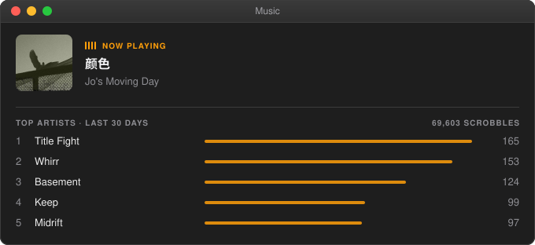

# Hello! Currently learning about Computer Science

<b>Click to know more about me 👀</b>

 

### About

### Stack

| Area | Technologies |
| :--- | :--- |
| **Languages** |  |
| **Systems and scripting** |  |
| **Web** |  |
| **Data and cloud** |  |
| **Game and design** |  |
| **Tools** |  |

 

### Listening

